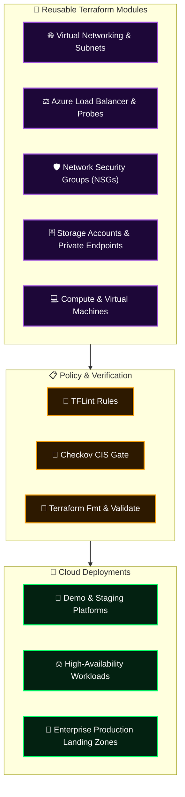

<div align="center">

# 🏗️ Terraform Enterprise Architecture & Modular IaC Library
### Production-Grade Azure Infrastructure as Code Modules & Deployment Blueprints

[](https://terraform.io)
[](https://azure.microsoft.com)
[](#-linting--compliance-standards)
[](#-modular-taxonomy)

**Engineered by [Mihir Maurya](https://github.com/MihirMaurya-dev) · Enterprise Cloud Architect & DevSecOps**

</div>

---

## 🏛️ Architectural Overview

This repository represents a structured, enterprise-grade **Terraform Infrastructure as Code (IaC) Library** for Microsoft Azure. Designed around modularity, immutability, and DRY (Don't Repeat Yourself) design patterns, each blueprint encapsulates security baselines, parameter validation, and resource isolation.



---

## 📂 Modular Taxonomy & Architecture Blueprints

| Component / Module | Scope & Architecture Pattern | Key Features |
|:---|:---|:---|
| ⚖️ **`terraform-loadbalancer-lab`** | High-Availability Ingress Architecture | Public/Internal Azure Standard Load Balancer, Frontend IP configurations, Backend Pools, TCP Health Probes, and Load Balancing Rules. |
| 🌐 **`terraform-azure-demo`** | Automated PR Deployment Blueprint | Includes GitHub Actions / Azure DevOps PR verification pipeline (`azure-pipelines-pr.yml`), automated plan generation, and remote backend integration. |
| 🛡️ **`resource-group`** | Core Governance & Metadata Foundation | Enterprise tagging taxonomy, regional deployment constraints, and CAF naming conventions. |
| 📦 **Enterprise Modules** | Core Foundation Components | Reusable modules for Virtual Networks, Subnet slicing, Network Security Group priority rules, and Managed Identities. |

---

## 🔒 Linting & Compliance Standards

All Terraform blueprints in this suite enforce:

1. **Strict Type Constraints & Input Validations**:
   Variables utilize custom validation blocks to prevent illegal CIDR blocks or non-standard naming schemes.
2. **State Concurrency & Lease Locking**:
   Configured for Azure Blob Storage remote backends with blob lease locking to prevent race conditions.
3. **Shift-Left Static Analysis**:
   Pre-merge linting using **TFLint** and security scanning via **Checkov** to enforce CIS Azure Benchmark standards.

---

## 🚀 Execution & Quickstart

```bash
# 1. Initialize Terraform provider plugins & remote state
terraform init

# 2. Enforce code formatting and structural validation
terraform fmt -check
terraform validate

# 3. Generate predictive execution plan
terraform plan -out=main.tfplan

# 4. Apply approved plan (immutable execution)
terraform apply main.tfplan
```

---

<div align="center">

**[Explore Portfolio](https://b18g119.online)** · **[Connect on LinkedIn](https://linkedin.com/in/mihirmauryaa)** · **[DevOps Knowledge Vault](https://github.com/MihirMaurya-dev/DevOps-Notes)**

</div>
